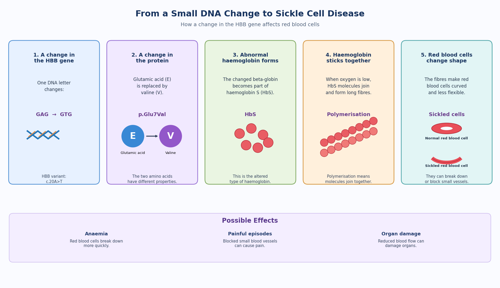

#  Analysis of the HBB Gene and Sickle Cell Mutation

## Project Overview

In this project, I explored the human **HBB gene** and its connection to sickle cell disease.

The HBB gene provides instructions for making the beta-globin subunit of haemoglobin, a protein in red blood cells that carries oxygen throughout the body.

I used Python and Biopython to analyse the HBB reference sequence, identify its coding region, translate it into a protein, and simulate the mutation associated with sickle cell disease. I also compared the normal and altered protein sequences and retrieved information about the variant from a public database.

## Background: Sickle Cell Disease

Sickle cell disease is an inherited blood disorder that affects haemoglobin and the shape and function of red blood cells.

It is associated with an altered form of haemoglobin called **haemoglobin S (HbS)**. This altered haemoglobin results from a change in the HBB gene in which glutamic acid is replaced by valine in the beta-globin protein.

When oxygen levels are low, HbS molecules can stick together and form long fibres. These fibres can make red blood cells stiff and sickle-shaped. The affected cells can break down more easily or block small blood vessels, causing anaemia, painful episodes and possible organ damage.

People who inherit two sickle-cell-associated haemoglobin alleles, such as HbSS, generally develop sickle cell disease. People with one HbS allele and one normal HbA allele (HbAS) usually have sickle cell trait.

## Project Objectives

The main objectives of this project were to:

- Retrieve and examine the human HBB reference sequence.
- Identify the coding sequence (CDS).
- Translate the coding sequence into a protein.
- Simulate the sickle-cell-associated mutation.
- Compare the normal and altered protein sequences.
- Retrieve clinical information about the variant.
- Understand the biological connection between the mutation and sickle cell disease.

## Tools and Resources

| Tool or Resource | Purpose |
|---|---|
| Python | Sequence analysis and mutation simulation |
| Google Colab | Writing and running Python code |
| Biopython | Reading sequences, identifying CDS and protein translation |
| NCBI RefSeq | Obtaining reference DNA and protein sequences |
| NCBI ClinVar | Retrieving clinical information about the variant |
| Matplotlib | Creating a diagram of the disease mechanism |

## Analysis Workflow

### 1. HBB Sequence Retrieval and Analysis

I retrieved the human HBB mRNA reference sequence from NCBI RefSeq.

- Organism: *Homo sapiens*
- Accession: NM_000518.5
- Sequence length: 628 nucleotides

I examined its nucleotide composition and calculated its GC content.

### 2. Coding Sequence Identification and Protein Translation

Using Biopython, I identified the coding sequence from the reference sequence annotation and translated it into a protein.

I then compared my translated sequence with the reference HBB protein (NP_000509.1) to check whether they matched.

### 3. Mutation Simulation and Protein Comparison

I simulated the HBB variant **NM_000518.5:c.20A>T** by changing the specified nucleotide in the coding sequence.

This changes the codon from GAG to GTG, replacing glutamic acid (E) with valine (V).

The resulting protein change is written as **p.Glu7Val**.

I compared the normal and altered protein sequences to identify the difference.

### 4. ClinVar Variant Retrieval

I searched NCBI ClinVar for the same variant to examine its reported clinical significance and review status.

### 5. Disease Mechanism Visualisation

I created a diagram to explain how the amino acid change is connected to altered haemoglobin, fibre formation under low-oxygen conditions, and changes in red blood cell shape. 

## Key Results

| Analysis | Result |
|---|---|
| HBB mRNA length | 628 nucleotides |
| CDS length | 444 nucleotides |
| Protein length | 147 amino acids |
| Normal codon | GAG |
| Altered codon | GTG |
| Amino acid change | Glutamic acid → Valine |
| Protein change | p.Glu7Val |
| Identical amino acid positions | 146 / 147 |
| Protein sequence identity | 99.32% |
| ClinVar classification | Pathogenic |

**Variant studied:** NM_000518.5:c.20A>T

**ClinVar Variation ID:** 15333

## Limitations

This project was carried out using computer-based analysis and publicly available reference data.

- I used a reference sequence rather than DNA data from a patient.
- The mutation was introduced through computer simulation.
- I did not perform laboratory experiments.
- I did not directly test haemoglobin fibre formation or red blood cell sickling.

The analysis demonstrates the genetic and protein changes associated with the variant. The explanation of how these changes contribute to sickle cell disease is based on established biological knowledge.

## Conclusion

Through this project, I gained practical experience in analysing a human gene sequence and understanding how a change in DNA can affect the protein it produces.

By studying the HBB gene and simulating the sickle-cell-associated mutation, I observed how a single nucleotide substitution can lead to an amino acid change in beta-globin.

This project also helped me connect sequence analysis with the biological role of the protein and its relationship to an inherited disease.

## References

1. **NCBI RefSeq – HBB mRNA (NM_000518.5)**  
   https://www.ncbi.nlm.nih.gov/nuccore/NM_000518.5

2. **NCBI RefSeq – HBB Protein (NP_000509.1)**  
   https://www.ncbi.nlm.nih.gov/protein/NP_000509.1

3. **NCBI ClinVar – HBB Variant (Variation ID: 15333)**  
   https://www.ncbi.nlm.nih.gov/clinvar/variation/15333/

4. **Biopython Documentation**  
   https://biopython.org/wiki/Documentation

5. **Matplotlib Documentation**  
   https://matplotlib.org/stable/
